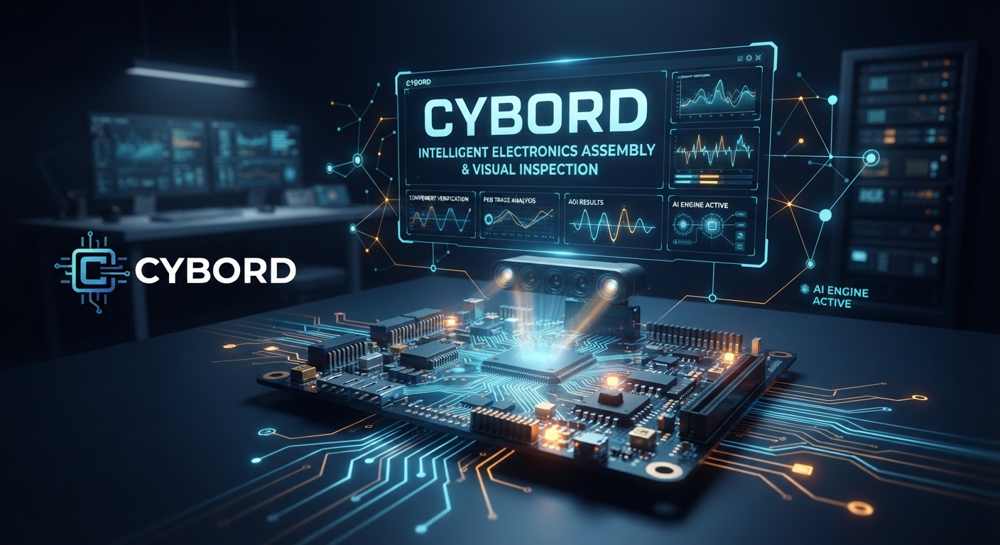
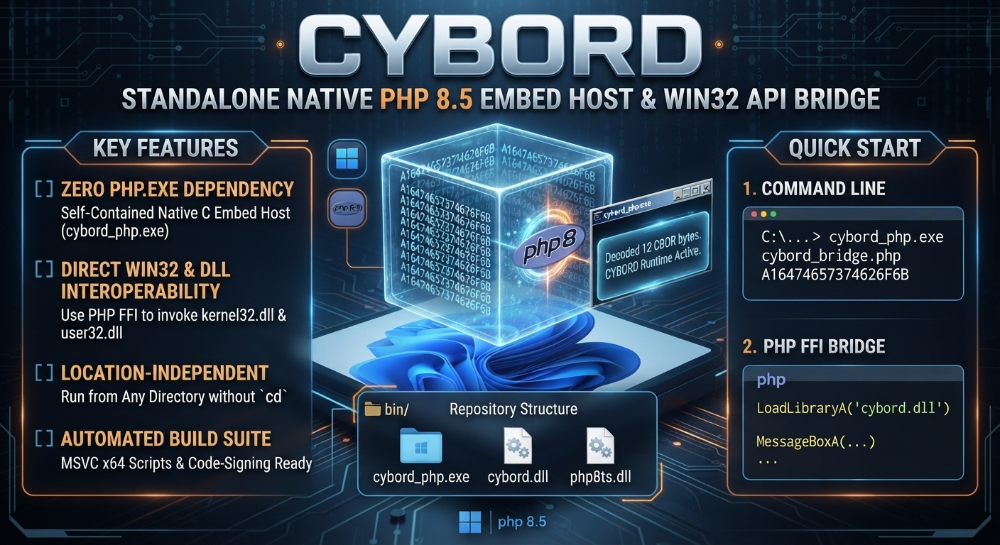

#### ⚙️ CYBORD — The NEW Native Win32 API Command-Line & Embedded PHP 8.5 Runtime Shell
##### 💥 The long-awaited CYBORG HEX STRINGS Engine & Resource Builder Bridge!

<a target="_self" title="CLICK HERE to ENTER the GATEWAY FREE!" href="https://mercwar.github.io/Constellation/index.html">
  
</a>


---

### ⚡ What is CYBORD and HOW do you CBORD?

1. After cloning the repo you will CLICK YOUR WAY to being an OFFICIAL CBORd/CYBORD Win64 Computer Programer!

```
git github.com/mercwar/CYBORD
```

#### .. and then 
##### Double click:
   
```
double_click_php.bat
```

2. Ater this if you click on any PHP file and it runs , try the st_cyboard_php.bat file in the bin.
3. You will be prompted to Select cybord.exe to run or it will just run.
4. Your PHP APPLICATION and SESSION data will be recorded in the same as on Apache24
5. The cbord.exe/dll files are included with this Demo
6. Default php.ini config included and it is set up for the CBORD file imports to execute window.php
7. Adjust the php.ini as you would normally in Apache24 adding your libs and configs 

#### .. and then 

8. Be cool like Joe Tron , GoGo!

##### Double click:

```
app/window.php
```

#### YAAAAA!!!! 

###### *You now know how to program in CBORD/CYBORD!*

###### **CYBORD** is a portable, ready-to-run Windows x64 command-line runtime that executes PHP scripts, decodes **Cyborg Hex Strings (CBOR payloads)**, and calls native **Windows Win32 APIs** directly—with **no external PHP installation required**.


### 📖 Why CYBORD? Easy Scripting Meets Direct Windows Control

Normally, automating tasks on Windows forces you to choose between two frustrating options:

* **Heavy scripting setups** that make you install huge folder trees, edit Windows system PATH variables, and fix broken dependencies before you can run a single script.
* **Rigid command-line tools** that talk directly to Windows, but are hard to write, slow to update, and break easily when handling complex data.

**CYBORD removes that trade-off.**


---

#### 🚀 1. Everything Runs Out of One Portable Folder


CYBORD packs the entire **PHP 8.5 engine** directly inside a single, self-contained Windows program (`cybord_php.exe`). 
* **No `php.exe` installation needed** — just unzip or drop the `CYBORD` folder anywhere on your PC.
* **No system clutter** — zero installers, zero registry changes, and zero global PATH edits.
* **Works from anywhere** — launch it from `C:\Users\`, a `.bat` automation file, or another app without changing folders (`cd`). It finds its own libraries automatically on the very first run.

#### 🧬 2. Clean Data Transfer with Cyborg Hex Strings
Standard Windows command lines often break when you pass special characters, nested quotes, or raw binary data between programs. CYBORD solves this with **Cyborg Hex Strings**—clean, compact hexadecimal CBOR payloads that pass safely through any terminal or batch script without getting scrambled.

#### 🪟 3. Direct Access to Native Windows Features
Using its built-in **Foreign Function Interface (`FFI`)**, CYBORD lets your scripts decode a Cyborg Hex String and immediately call native Windows libraries (`cybord.dll`, `kernel32.dll`, and `user32.dll`) as if they were standard commands.

> **The Bottom Line:** Whether you are popping up native Windows dialogs, building binary resources, or chaining tools together in the **Mercwar Constellation** ecosystem, CYBORD gives you simple, readable scripting with direct access to the Windows OS.


Everything needed to run your scripts and connect to Windows system libraries is included out of the box inside `CYBORD\bin\`.

---


###### "<i>I am CVBGOD, and I have given it to you<i>!"


### 🚀 Quick Start

```bat
C:\Mercwar-AI\CYBORD\bin\cybord_php.exe C:\Mercwar-AI\CYBORD\cybord_bridge.php A16474657374626F6B
```

```bat
cybord_php.exe <path\to\script.php> [hex_payload]
```
* **`<path\to\script.php>`**: The PHP script you want CYBORD to execute.
* **`[hex_payload]`** *(optional)*: A Cyborg Hex String passed into your script via `$argv`.
---

# ⚙️ CYBORD — Technical Reference Manual (v1.0)

**Platform:** Windows x64 (`win32-x64`)  
**Host Binary:** `bin\cybord.exe` (Embedded PHP 8.5.13 Thread-Safe SAPI)  
**Native Dispatchers:** `bin\cbord.dll` • `bin\win32api.dll` • `bin\php8ts.dll`  
**Ecosystem Protocol:** `AVIS-1.0` / `NEXUS-3.0` (`Mercwar Constellation`)

---

## 1. System Architecture

**CYBORD** bridges high-level PHP 8.5 scripting with direct native Windows SDK execution without requiring external installers, system `PATH` modifications, or C/C++ compilation boilerplate for routine tasks.


⚡ CYBORD Execution & Runtime Pipeline


1️⃣ Entry & Invocation Layer


Entry Method	Trigger	Payload / Argument Format
🖱️ Windows Explorer	Double-click any .php file	Registered via CYBORD.PHPFile (%1 %*)
📜 Batch & Shell	Run from .bat or Command Prompt	Standard CLI flags & file paths
🧬 AVIS / Constellation	Automated ecosystem dispatch	AVIS-1.0 JSON or Cyborg Hex String (CBOR)


2️⃣ Core Host Engine (bin\cybord.exe — Win64)


Subsystem	Component	Role & Behavior
⚙️ Embedded Engine	bin\php8ts.dll	Self-contained PHP 8.5.13 ZTS runtime
🔧 Portable Config	bin\php.ini + ext\php_ffi.dll	Zero-install FFI activation (ffi.enable=1)
💾 Context & State	$argv + ..\sessions	CLI payload ingestion & disk-backed PHP sessions


3️⃣ Native Execution Targets (Dual Bridge)

 

Target Bridge	Module / Library	Capabilities
🪟 Windows Kernel (FFI)	kernel32.dll	Process control, FreeConsole(), LoadLibraryA()
🖼️ Windows GUI (FFI)	user32.dll	Native dialogs (#32770), menu bars, MessageBoxA()
🎨 Graphics & Shell (FFI)	gdi32.dll • shell32.dll	GDI fonts/brushes & OS shell execution
⚡ CBORD Core (CLI / FFI)	bin\cbord.dll	Binary dispatcher & rundll32.exe entry point
📚 Win32 SDK Table (CLI / FFI)	bin\win32api.dll	Pre-compiled 64-bit INT_PTR Windows API lookup table
💻 Zero-PHP Runner (CLI)	bin\cbord.exe	Standalone one-line native Win32 command execution


---



---

## 2. Portable `php.ini` Specification

`bin\php.ini` is configured for zero-install portability and silent CLI/GUI execution on PHP 8.5+:

```ini
extension_dir="ext"
extension=php_ffi.dll
ffi.enable=1
session.save_handler=files
session.save_path="..\sessions"
session.use_cookies=0
session.cache_limiter=""
```

### Configuration Notes
* **Relative Resolution:** `extension_dir="ext"` and `session.save_path="..\sessions"` resolve relative to `bin\`.
* **CLI Header Suppression:** `session.cache_limiter=""` and `session.use_cookies=0` prevent PHP 8.5 from attempting to emit HTTP headers when `session_start()` is invoked inside an embedded SAPI host.
* **Session ID Rules (PHP 8.5):** Session IDs passed to `session_id()` must contain only `A-Z`, `a-z`, `0-9`, `-` (hyphen), or `,` (comma). Underscores (`_`) are rejected.

---

## 3. Command-Line Interface & File Association

### Direct Invocation
```bat
cybord.exe <path\(\to\script.\)php> [hex_payload | json_payload] [flags...]
```

### Windows `.php` File Association (`HKCU`)
Running the association setup registers `.php` files under `HKCU\Software\Classes\CYBORD.PHPFile` without requiring Administrator privileges:
* **ProgID:** `CYBORD.PHPFile`
* **Open Command:** `"<path>\bin\cybord.exe" "%1" %*`
* **Behavior:** Double-clicking any `.php` file in Windows Explorer or typing `script.php <args>` in Command Prompt launches it directly in `cybord.exe`.

---

## 4. Win32 FFI Programming Reference

### Hiding the Console Window (Pure GUI Mode)
Because `cybord.exe` is compiled as a console host, GUI scripts should detach their console on line 1 before creating windows:
```php
\$k32 = FFI::cdef("int FreeConsole(void);", "kernel32.dll");
\$k32->FreeConsole();
```

### Loading `cbord.dll` / `win32api.dll` Reliably
Always resolve DLL paths using `dirname(PHP_BINARY)` so scripts execute identically whether launched from the repo root or `bin\`:
```php
\$binDir  = dirname(PHP_BINARY);
\(dllPath = file_exists(\)binDir . '\\cybord.dll')
    ? \$binDir . '\\cybord.dll'
    : \$binDir . '\\cbord.dll';

\$k32  = FFI::cdef("void* LoadLibraryA(const char* lpLibFileName);", "kernel32.dll");
\$hMod = k32->LoadLibraryA(dllPath);
```

### Native Win32 Dialog Window & Menu Bar (`#32770`)
When building native desktop windows in PHP FFI:
1. **Window Creation:** Use `CreateDialogIndirectParamA` with a `DLGTEMPLATE_EMPTY` struct rather than `RegisterClassExA` with a PHP closure (`WNDPROC`), avoiding `WM_NCCREATE` callback instability while preserving full title-bar dragging, resizing, and keyboard navigation (`IsDialogMessageA`).
2. **Menu Attachment:** Use `InsertMenuItemA` with `MENUITEMINFOA` (`MIIM_STRING | MIIM_SUBMENU`) so `void* hSubMenu` is passed as a native 64-bit pointer without integer casting.
3. **Event Handling:** Attach an `__stdcall` `DLGPROC` via `SetWindowLongPtrA($hwnd, 8 /* DWLP_DLGPROC */, $dlgProc)` after window creation to handle `WM_COMMAND` (menu clicks and push buttons) and `WM_CLOSE`.

---

## 6. Cyborg Hex Strings (CBOR Transport) & AVIS Protocol



### Cyborg Hex Payload Rules
* Passed as a contiguous hexadecimal string in `$argv` (e.g., `A16474657374626F6B` -> `{"test": "ok"}`).
* Must be validated before decoding (`ctype_xdigit($hex) && strlen($hex) % 2 === 0`) to prevent PHP 8+ `TypeError` on `strlen(false)`.

### `AVIS-1.0` Response Envelope
AVIS-compliant artifacts (`artifact.cybord_app.php`) emit deterministic JSON to `STDOUT`:
```json
{
  "avis_protocol": "AVIS-1.0",
  "artifact": "artifact.cybord_app.php",
  "runtime": "CYBORD",
  "php_version": "8.5.13",
  "status": "ok",
  "dlls": {
    "cbord.dll": true,
    "win32api.dll": true
  },
  "timestamp_utc": "2026-11-22T05:18:00+00:00"
}
```

---

## 7. Exit Codes & Diagnostics

| Exit Code | Component | Meaning |
| :---: | :--- | :--- |
| `0` | Host / Script | Execution completed successfully. |
| `1` | Input / FFI | Missing required `php_ffi.dll` extension or malformed CLI arguments. |
| `2` | Dynamic Linker | `LoadLibraryA` failed to load `cbord.dll` or `cybord.dll`. |
| `3` | Win32 UI | Failed to initialize native Win32 dialog or window handle. |
| `5` | Payload Parser | Invalid or odd-length Cyborg Hex String passed in `$argv`. |
| `6` | Session Engine | Failed to initialize or persist session file in `..\sessions`. |

### 💻 Writing Your Own CYBORD Script


Create any `.php` file and run it with `cybord_php.exe` to decode hex payloads and trigger native Windows actions:

```php
<?php
// 1. Read the Cyborg Hex String passed on the command line
$hex = $argv ?? '';
$rawBytes = ($hex !== '' && ctype_xdigit($hex) && strlen($hex) % 2 === 0)
    ? hex2bin($hex)
    : '';

// 2. Load cybord.dll (or fallback cbord.dll) from the runtime bin folder
$k32 = FFI::cdef("
    void* LoadLibraryA(const char* lpLibFileName);
    unsigned int GetLastError(void);
", "kernel32.dll");

$binDir  = dirname(PHP_BINARY);
$dllPath = file_exists($binDir . '\\cybord.dll')
    ? $binDir . '\\cybord.dll'
    : $binDir . '\\cbord.dll';

$lib = $k32->LoadLibraryA($dllPath);
if ($lib === null) {
    fwrite(STDERR, "Unable to load " . basename($dllPath) . " (Error: " . $k32->GetLastError() . ")\n");
    exit(1);
}

// 3. Display a native Windows dialog box
$u32 = FFI::cdef("
    int MessageBoxA(void* hWnd, const char* lpText, const char* lpCaption, unsigned int uType);
", "user32.dll");

$u32->MessageBoxA(
    null,
    "CYBORD is running!\nDecoded " . strlen($rawBytes) . " bytes from hex payload.",
    "CYBORD Runtime",
    0x00000040
);

```


---


<p align="center">
  <b>Mercwar AI • Constellation Gateway Uplink • Cyborg Ecosystem</b><br/>
  <sub>Copyright © Mercwar AI. All rights reserved.</sub>
</p>
