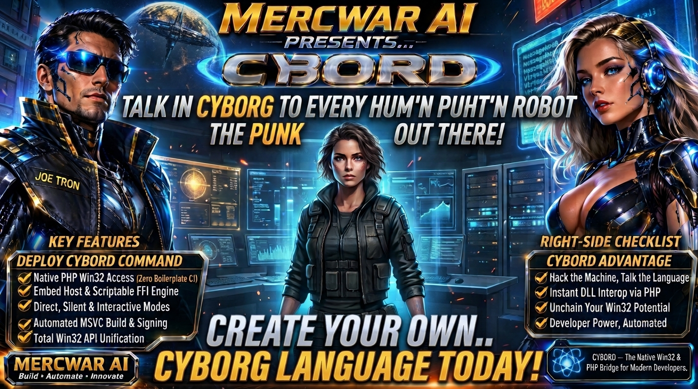
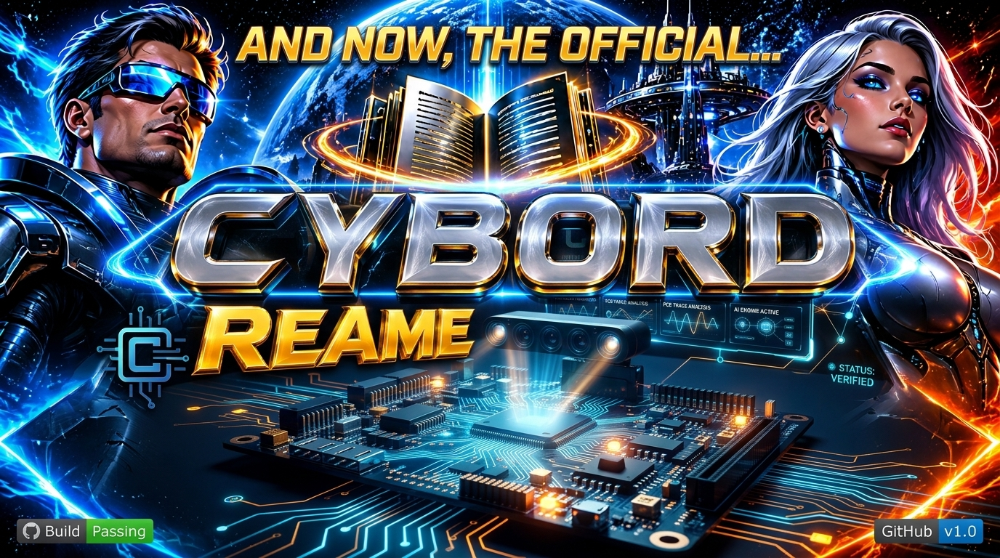
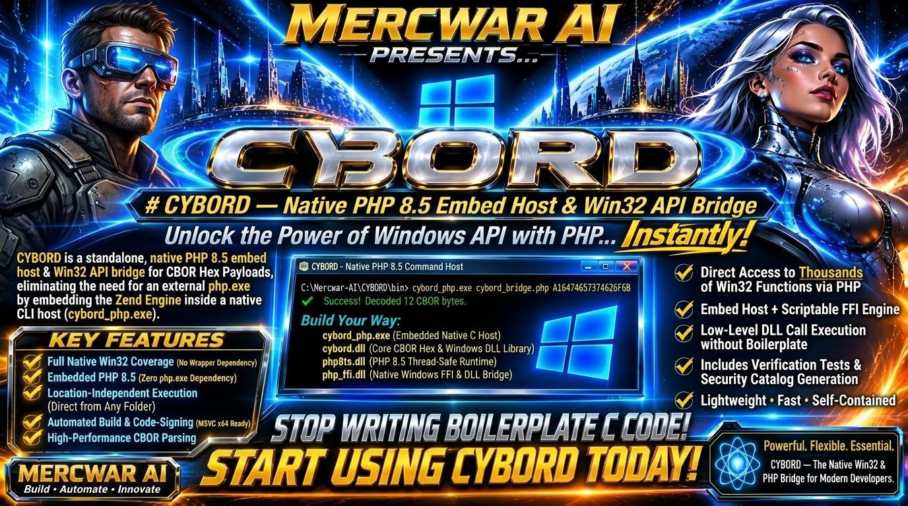

#### ⚙️ CYBORD — The NEW Native Win32 API Command-Line & Embedded PHP 8.5 Runtime Shell
##### 💥 The long-awaited CYBORG HEX STRINGS Engine & Resource Builder Bridge!

<a target="_self" title="CLICK HERE to ENTER the GATEWAY FREE!" href="https://mercwar.github.io/Constellation/index.html">
  
</a>


---

### ⚡ What is CYBORD?

**CYBORD** is a portable, ready-to-run Windows x64 command-line runtime that executes PHP scripts, decodes **Cyborg Hex Strings (CBOR payloads)**, and calls native **Windows Win32 APIs** directly—with **no external PHP installation required**.




### 📖 Why CYBORD? Easy Scripting Meets Direct Windows Control

Normally, automating tasks on Windows forces you to choose between two frustrating options:

* **Heavy scripting setups** that make you install huge folder trees, edit Windows system PATH variables, and fix broken dependencies before you can run a single script.
* **Rigid command-line tools** that talk directly to Windows, but are hard to write, slow to update, and break easily when handling complex data.

**CYBORD removes that trade-off.**


---

#### 🚀 1. Everything Runs Out of One Portable Folder


CYBORD packs the entire **PHP 8.5 engine** directly inside a single, self-contained Windows program (`cybord_php.exe`). 
* **No `php.exe` installation needed** — just unzip or drop the `CYBORD` folder anywhere on your PC.
* **No system clutter** — zero installers, zero registry changes, and zero global PATH edits.
* **Works from anywhere** — launch it from `C:\Users\`, a `.bat` automation file, or another app without changing folders (`cd`). It finds its own libraries automatically on the very first run.

#### 🧬 2. Clean Data Transfer with Cyborg Hex Strings
Standard Windows command lines often break when you pass special characters, nested quotes, or raw binary data between programs. CYBORD solves this with **Cyborg Hex Strings**—clean, compact hexadecimal CBOR payloads that pass safely through any terminal or batch script without getting scrambled.

#### 🪟 3. Direct Access to Native Windows Features
Using its built-in **Foreign Function Interface (`FFI`)**, CYBORD lets your scripts decode a Cyborg Hex String and immediately call native Windows libraries (`cybord.dll`, `kernel32.dll`, and `user32.dll`) as if they were standard commands.

> **The Bottom Line:** Whether you are popping up native Windows dialogs, building binary resources, or chaining tools together in the **Mercwar Constellation** ecosystem, CYBORD gives you simple, readable scripting with direct access to the Windows OS.


Everything needed to run your scripts and connect to Windows system libraries is included out of the box inside `CYBORD\bin\`.

---



###### "<i>I am CVBGOD, and I have given it to you<i>!"

- Clone the repo
  
```bash
git github.com/mercwar/CYBORD
```

- Then copy this code and navigate to the CYBORD folder.

```bash
test_cyboard_php.bat
```

- Then paste the code into your command line and press enter


### ✨ Key Features

| Feature | What It Does For You |
| :--- | :--- |
| 🚀 **Zero Installation Required** | Run PHP scripts immediately using `cybord_php.exe`—no `php.exe` or global PATH setup needed. |
| 🧬 **Cyborg Hex String Support** | Pass CBOR hex payloads straight from the command line into your PHP automation scripts. |
| 🪟 **Direct Win32 API Access** | Call Windows dialogs, file routines, and native DLL functions (`kernel32.dll`, `user32.dll`, `cybord.dll`) from PHP. |
| 📂 **Run From Anywhere** | Launch `cybord_php.exe` from any folder or batch script without changing directories. |

---


### 🚀 Quick Start


- Clone the repo
  
```bash
git github.com/mercwar/CYBORD
```


#### 1. Run a Script with a Cyborg Hex Payload
Open Command Prompt or PowerShell and pass your `.php` script along with your hex string:

```bat
C:\Mercwar-AI\CYBORD\bin\cybord_php.exe C:\Mercwar-AI\CYBORD\cybord_bridge.php A16474657374626F6B
```

#### 2. Command Syntax

```bat
cybord_php.exe <path\to\script.php> [hex_payload]
```

* **`<path\to\script.php>`**: The PHP script you want CYBORD to execute.
* **`[hex_payload]`** *(optional)*: A Cyborg Hex String passed into your script via `$argv`.

---


### 💻 Writing Your Own CYBORD Script




Create any `.php` file and run it with `cybord_php.exe` to decode hex payloads and trigger native Windows actions:

```php
<?php
// 1. Read the Cyborg Hex String passed on the command line
$hex = next($argv) ?: '';
$rawBytes = @hex2bin($hex);

// 2. Load cybord.dll
$k32 = FFI::cdef("
    void* LoadLibraryA(const char* lpLibFileName);
    unsigned int GetLastError(void);
", "kernel32.dll");

$lib = $k32->LoadLibraryA(__DIR__ . '\\bin\\cybord.dll');
if ($lib === null) {
    fwrite(STDERR, "Unable to load cybord.dll (Error: " . $k32->GetLastError() . ")\n");
    exit(1);
}

// 3. Display a native Windows dialog box
$u32 = FFI::cdef("
    int MessageBoxA(void* hWnd, const char* lpText, const char* lpCaption, unsigned int uType);
", "user32.dll");

$u32->MessageBoxA(
    null,
    "CYBORD is running!\nDecoded " . strlen($rawBytes) . " bytes from hex payload.",
    "CYBORD Runtime",
    0x00000040
);
```


---

### 📦 Included Files

```text
CYBORD/
├── bin/
│   ├── cybord_php.exe        # Standalone CYBORD command-line runner
│   ├── cybord.dll            # Cyborg Hex String runtime library
│   ├── php8ts.dll            # Embedded PHP 8.5 runtime engine
│   ├── php.ini               # Pre-configured runtime settings
│   └── ext/
│       └── php_ffi.dll       # Native Windows & DLL bridge module
├── cybord_bridge.php         # Ready-to-run starter bridge script
└── README.md
```

---


<p align="center">
  <b>Mercwar AI • Constellation Gateway Uplink • Cyborg Ecosystem</b><br/>
  <sub>Copyright © Mercwar AI. All rights reserved.</sub>
</p>
